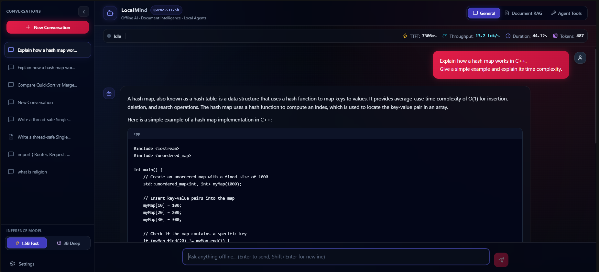
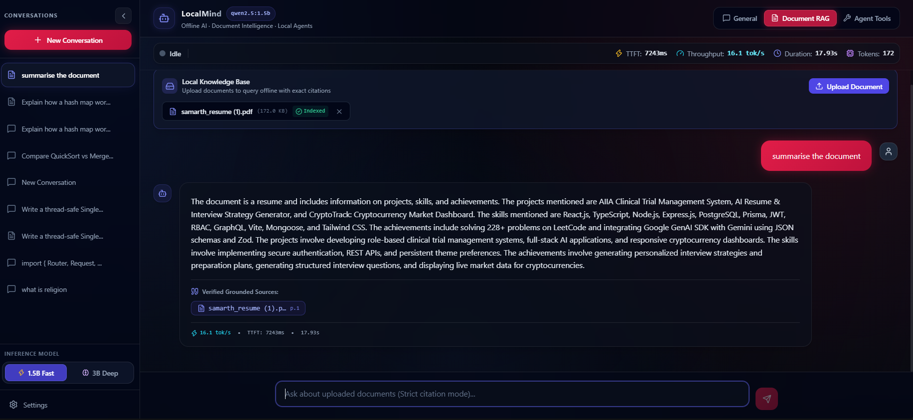
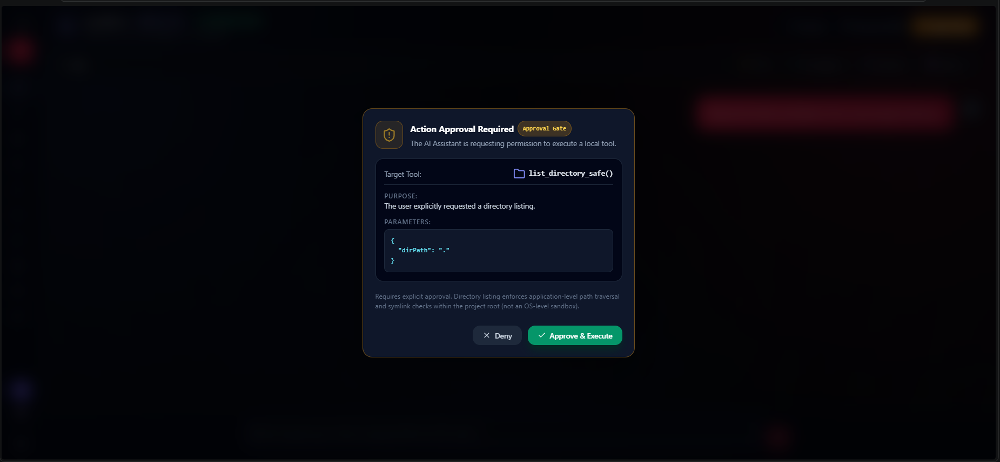
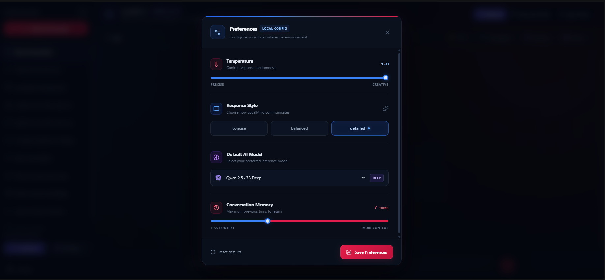
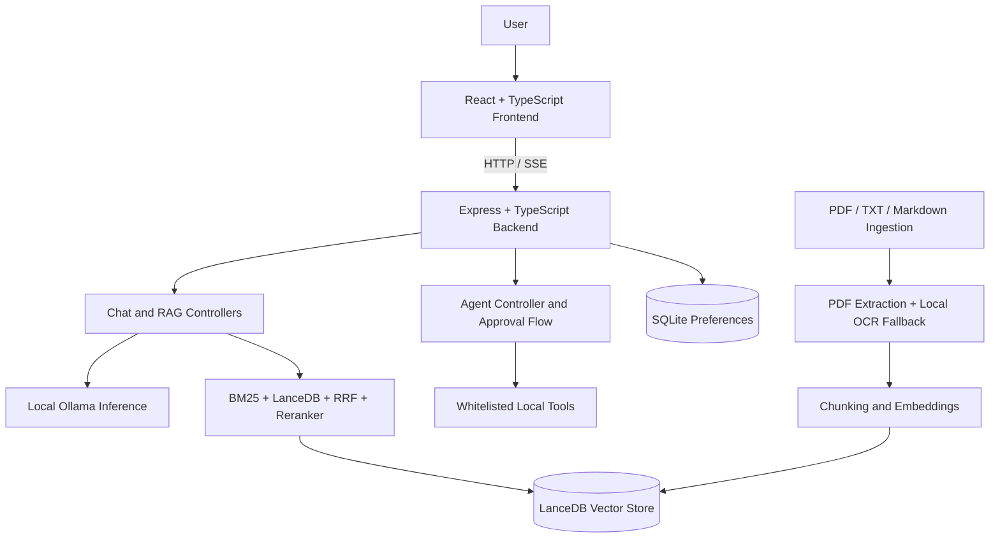

# LocalMind — Offline Local AI Assistant with RAG

**A locally operated AI assistant for conversational chat, document-grounded question answering, and human-approved agent tools.**

LocalMind combines local Ollama inference with a document retrieval pipeline and a small, explicitly approved set of local tools. The application supports general chat, document mode with citations, and agent mode. Its design keeps model inference, document processing, vector storage, and preference persistence on the user's machine when the required assets are installed locally.

## Engineering Highlights

- **Hybrid RAG retrieval:** Combines BM25 keyword search and LanceDB vector search using Reciprocal Rank Fusion (RRF), followed by local cross-encoder reranking.
- **Document ingestion with OCR fallback:** Extracts PDF, TXT, and Markdown content, creates structured chunks, and uses local Tesseract OCR when PDF text extraction indicates scanned or mixed pages.
- **Citation-grounded responses:** Builds citations from the excerpts included in the final model context rather than retrieval candidates that were subsequently discarded.
- **Human-approved agent tools:** Routes requests to a fixed tool whitelist and requires explicit user approval before execution.
- **Session-bound, single-use approvals:** Validates UUID approval tokens against the issuing browser session and a five-minute expiry. Tool arguments are retained server-side.
- **Filesystem safeguards:** Checks path traversal, canonical paths, and symbolic links for the directory-listing tool.
- **SSE streaming and telemetry:** Streams responses incrementally, supports cancellation, and reports timing and token metrics when Ollama provides the required metadata.

## Application Preview

### 1. General Chat

Demonstrates conversational interaction with a locally running language model.



### 2. Document Q&A with Citations

Demonstrates document-grounded responses with source citations from uploaded documents.



### 3. Agent Approval

Demonstrates the human-in-the-loop approval interface before an agent executes a local tool.



### 4. Telemetry and Settings

Shows the application's configurable preferences and local model settings.



## Architecture



For implementation details, see [Architecture](docs/ARCHITECTURE.md) and [Security](docs/SECURITY.md).

## Technology Stack

| Area | Technology | Purpose |
|---|---|---|
| Frontend | React 19, TypeScript, Vite | Interactive client and build tooling |
| Styling | Tailwind CSS 3 | Utility-based styling |
| UI / Markdown | Lucide React, React Markdown, remark-gfm | Icons and formatted assistant responses |
| Backend | Node.js, Express 5, TypeScript | API, orchestration, and streaming |
| Validation | Zod | Request and agent-decision validation |
| Local inference | Ollama | Chat generation and embeddings |
| Vector storage | LanceDB | Persistent embedding and vector records |
| Keyword retrieval | wink-bm25-text-search, wink-nlp-utils | BM25 retrieval |
| Reranking | Transformers.js (`@xenova/transformers`) | Local cross-encoder reranking |
| Document processing | pdf-parse, Tesseract.js | PDF extraction and OCR fallback |
| Preferences | better-sqlite3 | Local preference persistence |
| Upload handling | Multer | In-memory, size-limited document uploads |

## Run Locally

### Prerequisites

- Node.js and npm.
- Ollama installed and running locally.
- Required model assets available locally before running without internet access.
- Local reranker assets (`Xenova/ms-marco-MiniLM-L-6-v2`) cached for Transformers.js. The backend disables remote model downloads.
- English Tesseract trained data file. The project includes `server/eng.traineddata`.

Pull the Ollama models used by the current UI/default configuration:

```bash
ollama pull qwen2.5:1.5b
ollama pull qwen2.5:3b
ollama pull nomic-embed-text
```

### 1. Configure and Start the Backend

```bash
cd server
npm install
```

Copy `server/.env.example` to `server/.env` and configure the values for your machine.

The backend defaults to:

- Port: `5000`
- Ollama URL: `http://127.0.0.1:11434`
- Chat model: `qwen2.5:1.5b`
- Embedding model: `nomic-embed-text`

Start the backend:

```bash
npm run dev
```

### 2. Configure and Start the Frontend

Open a second terminal:

```bash
cd client
npm install
```

Copy `client/.env.example` to `client/.env`.

Set `VITE_API_URL` if the backend is not running at `http://localhost:5000`.

Start the frontend:

```bash
npm run dev
```

Open the Vite URL printed in the terminal, normally:

`http://localhost:5173`

The backend's `CLIENT_ORIGIN` must match the frontend origin when it differs from the default.

### Useful Checks

Run these commands from their respective directories.

**Client:**

```bash
npm run build
npm run lint
```

**Server:**

```bash
npm run build
npm test
```

The server test command runs the Node test-runner suites in `server/test`. These commands are provided as verification steps; successful execution on every machine is not implied.

## Project Documentation

| Document | Description |
|---|---|
| [Client README](client/README.md) | Frontend structure, components, state management, and API communication |
| [Server README](server/README.md) | Backend architecture, API routes, RAG pipeline, and agent execution |
| [Architecture](docs/ARCHITECTURE.md) | System architecture and internal data flows |
| [Security](docs/SECURITY.md) | Security mechanisms, approval lifecycle, and known limitations |

## Current Scope and Limitations

- The application is designed for local use; no hosted deployment or production service is documented here.
- Offline operation depends on having Ollama models, reranker assets, npm dependencies, and OCR data available locally. Initial setup and model acquisition may require internet access.
- Agent approvals are held in process memory. Pending approvals do not survive a backend restart and are not shared across multiple backend instances.
- Filesystem checks are application-level safeguards, not an operating-system sandbox.
- Retrieval and reranking scores are ranking signals, not calibrated answer-confidence values.

## License

No project license file was present in the inspected archive. Add a license before publishing if you intend to grant reuse rights.