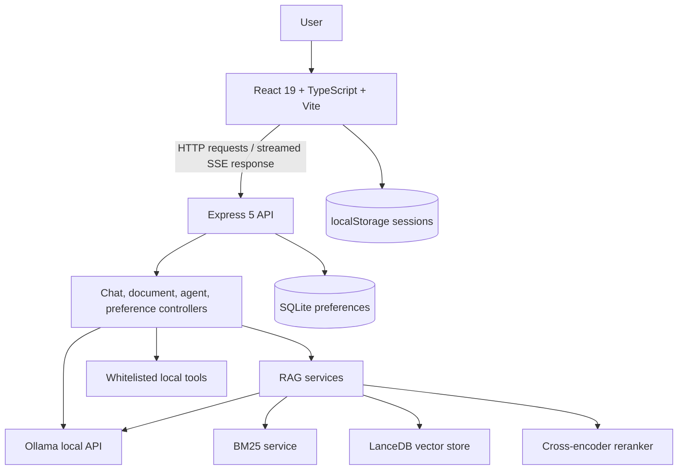
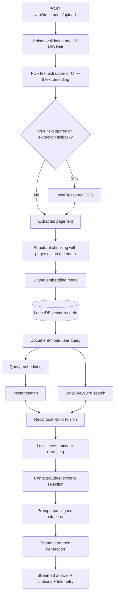

# LocalMind Architecture

This document describes the architecture present in the inspected source tree. It focuses on the main runtime paths rather than general AI/RAG concepts.

## 1. System overview

The React client communicates with an Express API over HTTP. Chat, RAG, and agent generation endpoints stream events to the browser using SSE framing over a `fetch()` response stream. The backend delegates local inference and embedding generation to Ollama, stores document vectors in LanceDB, stores preferences in SQLite, and runs a small set of approved local tools.



## 2. Frontend/backend communication

The client resolves its API origin from `VITE_API_URL`, defaulting to `http://localhost:5000`. `App.tsx` owns the high-level UI state and delegates generation/stream lifecycle to `useSSEStream`.

| User mode | Backend endpoint |
|---|---|
| General | `POST /api/chat/stream` |
| Document | `POST /api/chat/rag/stream` |
| Agent | `POST /api/chat/agent/stream` |

The hook posts JSON using `fetch`, reads the response body as a stream, decodes UTF-8 chunks, and passes the data to the SSE parser. The client uses `AbortController` for explicit cancellation and cleanup. Agent requests include browser credentials so the backend's session cookie is sent.

## 3. Document ingestion and RAG flow



### Ingestion details

- Multer stores the single uploaded file in memory and enforces a 10 MiB limit.
- Supported document extensions are PDF, TXT, and Markdown.
- PDF extraction preserves page boundaries. Sparse-page detection can trigger OCR for scanned or mixed-content PDFs.
- OCR uses local Tesseract English trained data and applies page, timeout, total-budget, and concurrency limits.
- Chunk records carry a stable ID, file name, page number/range, chunk index, text, and optional section/content-type metadata.
- Embeddings are requested from the configured Ollama embedding model and normalized before cosine-distance search.

### Retrieval and answer construction

The RAG controller obtains candidates from the BM25 and vector retrieval paths. It fuses rankings with Reciprocal Rank Fusion, optionally reranks the candidates with a local cross-encoder, and selects excerpts within the configured context budget. Citation metadata is aligned to the final excerpts included in the prompt. The resulting prompt is sent to Ollama, whose response is streamed to the client.

The reranker uses `Xenova/ms-marco-MiniLM-L-6-v2` through Transformers.js. Remote downloads are disabled in the runtime configuration; local model assets therefore need to be present for reranking in a fully offline environment. If reranking fails, the service can fall back to the incoming candidate order.

## 4. Agent execution flow

```mermaid
sequenceDiagram
    participant U as User
    participant FE as React client
    participant API as Agent controller
    participant LLM as Local Ollama
    participant Store as Pending approval Map
    participant Tool as ToolService

    U->>FE: Submit agent request
    FE->>API: POST /api/chat/agent/stream + session cookie
    API->>LLM: Request structured routing decision
    LLM-->>API: Proposed tool / response
    API->>API: Parse and validate decision
    alt Tool requires approval
        API->>Store: Save tool, args, session, expiry
        API-->>FE: Stream pending action + approval token
        FE-->>U: Show approval modal
        U->>FE: Approve
        FE->>API: POST /api/chat/agent/tools/execute + token + cookie
        API->>Store: Validate token, session, expiry; consume token
        API->>Tool: Execute server-stored tool arguments
        Tool-->>API: Tool result
        API-->>FE: Return execution result
    else No tool approval path
        API-->>FE: Stream response / status events
    end
```

The currently registered tools are `get_system_specs`, `list_directory_safe`, `calculate_math`, and `get_current_time`. The controller validates the model's structured decision against a schema and the tool whitelist. Approval state is held in a process-local Map; it is not a durable or distributed job store.

## 5. Persistence responsibilities

| Store | Responsibility | Lifetime |
|---|---|---|
| LanceDB | Document chunk embeddings and vector retrieval | Persistent local data directory |
| SQLite (`better-sqlite3`) | User preferences | Persistent local database at `server/data/preferences.db` |
| In-memory chunk cache | Accelerate chunk lookups | Backend process lifetime; bounded by entry/byte limits |
| Pending approval Map | Track unconsumed tool approvals | Backend process lifetime |
| Browser `localStorage` | Chat sessions and current session state | Browser profile lifetime, subject to browser storage clearing |

The vector store uses collection versioning/cache invalidation and a failure-aware append-then-prune replacement strategy. SQLite is used for preferences, not chat history.

## 6. Streaming and telemetry

The server emits SSE-framed events and wires request/response lifecycle cancellation into an `AbortSignal`. The signal is passed through the relevant retrieval and generation stages. The frontend parser handles partial frames across network chunks.

Telemetry records time to first token on the server, total duration, Ollama-reported generated token count, generation throughput, optional prompt token count, and completion status. Token count and throughput are not inferred from the number of text fragments received by the browser.

## 7. Important design decisions

- **Local inference boundary:** Ollama is the model runtime; the application does not route prompts to a hosted LLM API.
- **Hybrid retrieval:** lexical and semantic search provide complementary candidate sets before rank fusion and reranking.
- **Evidence-aligned citations:** citations are constructed from the excerpts retained in the final prompt.
- **Bounded processing:** upload size, OCR concurrency/time/page limits, reranker input limits, and cache bounds constrain resource use.
- **Explicit tool approval:** model-generated tool intent does not itself authorize execution.
- **Local persistence split:** vectors, preferences, browser sessions, and ephemeral approval state have separate storage responsibilities.

For security controls and limitations, see [SECURITY.md](SECURITY.md).
